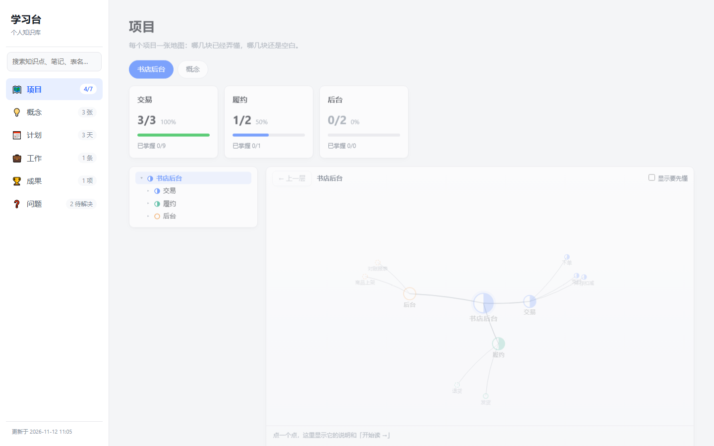

# learning-desk · 学习台

**English.** learning-desk turns your conversations with Claude Code into a personal knowledge base. While you learn a codebase or a subject, Claude writes notes, concept cards, daily plans and open questions into a folder of Markdown files, and a hook rebuilds an offline web page after every change. It is made for getting up to speed at a new job, understanding an unfamiliar project, or studying on your own. Requires Claude Code, Python 3.10+ and git. The interface and file formats are in Chinese.

和 Claude Code 边聊边学：Claude 把你弄懂的东西、冒出来的问题、每天的计划直接记进一个 Markdown 知识库，每次改动后自动生成一个离线网页。打开网页就能看到这个项目懂了多少、哪块还空着、今天的计划做完没有、还有哪些问题没解决。



## 适合谁

- **个人学习**：学一门技术、读一本书，每天的进度和弄懂的概念都留下来，回头能顺着地图复习。
- **新工作上手**：边干活边记，问题按"该问谁"分好列，找人之前一眼看到要问什么。
- **快速了解一个项目**：先给项目搭一张地图，读到哪记到哪，哪块还没碰过一目了然。

## 十分钟上手

需要：Python 3.10 或更新、git、[Claude Code](https://claude.com/claude-code)。网页生成用到一个 Python 库 `markdown`，第二条命令会装上它。macOS、Linux 上如果只有 `python3`，把命令里的 `python` 换成 `python3`。

```bash
git clone https://github.com/banma05/learning-desk.git
python -m pip install -r learning-desk/requirements.txt
python learning-desk/install.py D:/我的知识库
```

安装时会问一句：这个知识库主要用来**自学**，还是**工作上手、了解项目**。装好以后：

1. 双击 `D:/我的知识库/学习台.html`，现在还是空的。
2. 新开一个 Claude Code 会话，说一句"帮我填一下维护约定的第一节"。
3. 之后在任何项目里照常和 Claude 聊，它会按约定边聊边记。

想先看看会改哪些地方，加上 `--dry-run`。详细步骤见 [教程](docs/教程.md)。

## 先看看填满的样子

双击 [`示例/学习台.html`](示例/学习台.html)：一个虚构的"网上书店"项目，记了三天。

## 它是怎么工作的

- **`维护约定.md`** 是写给 Claude 看的规则：怎么讲、记什么、记在哪、用什么格式。安装脚本在 Claude Code 的用户级 `CLAUDE.md` 里加一行导入它，所以每个会话都会遵守。规则想改就改这个文件。
- **两个钩子**：会话开始时告诉 Claude"今天到哪了"；Claude 每次改了知识库里的文件，就重新生成网页，并做一次 git 提交。
- **都在你自己的电脑上**：网页完全离线，知识库是一个没有远程的 git 仓库。

## 目录

| 位置 | 是什么 |
|---|---|
| `install.py` | 新建知识库并接到 Claude Code；也能 `--update`（更新工具）、`--uninstall`（从 Claude Code 里去掉） |
| `模板/` | 新知识库的初始内容 |
| `工具/` | 生成网页的脚本和两个钩子 |
| `示例/` | 填好的示例知识库 |
| `docs/` | [教程](docs/教程.md)、[格式说明](docs/格式说明.md)、[设计](docs/design.md) |

## 注意

知识库里是你自己的笔记，可能有工作内容。**不要把知识库推到公开仓库**，也不要把它放在这个仓库的文件夹里（安装脚本会拒绝）。

## 许可证

[MIT](LICENSE)
